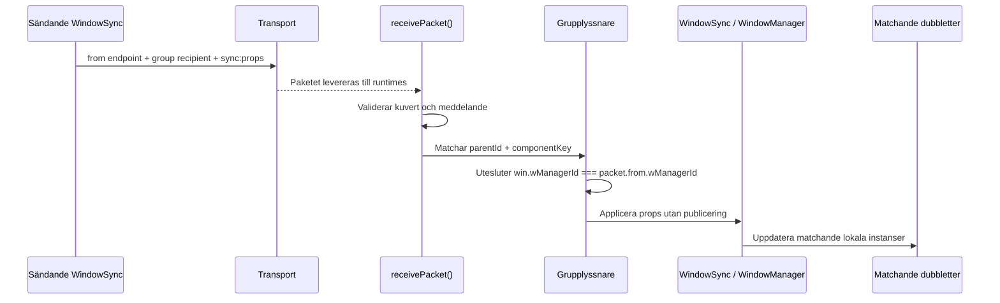
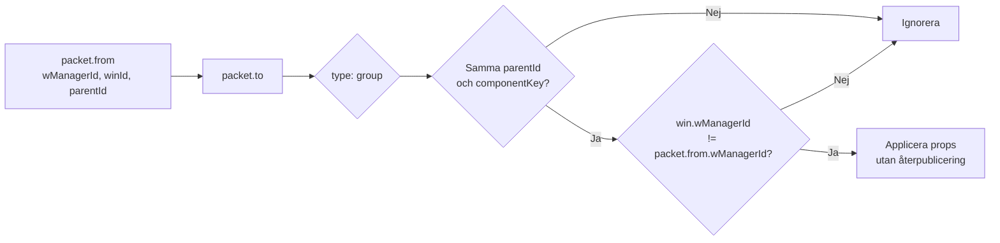

# Sync-routing

Every transport packet has an explicit sender, recipient and message:

```ts
{
  from: { wManagerId, winId, parentId },
  to: { type: "group", parentId, componentKey },
  message: { type: "sync:props", props }
}
```

Props messages are delivered to every local window session matching
`to.parentId` and `to.componentKey`, except windows whose `wManagerId` matches
the sender runtime. State and RPC messages remain targeted at one window.
Incoming updates are applied without being published again.




